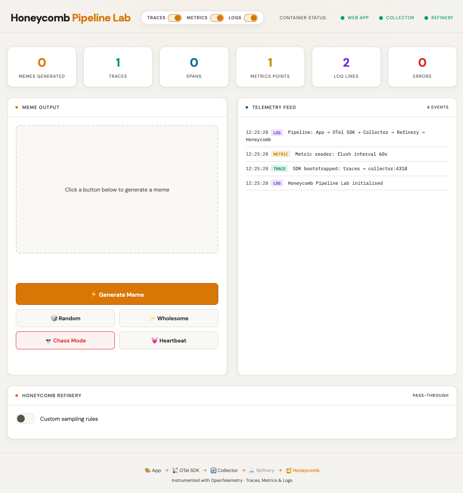
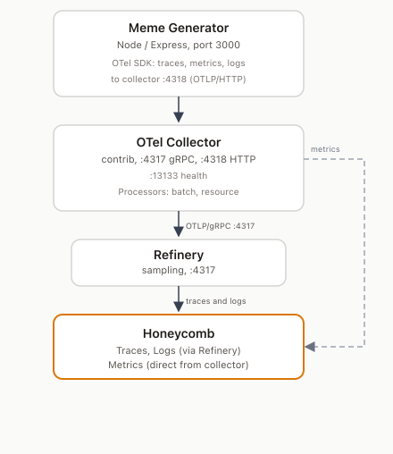

# Honeycomb Pipeline Lab 🎨🔭

A fully-instrumented web app that generates observability-themed memes while producing **real OpenTelemetry traces, metrics, and logs** — all routed through an OTel Collector and Refinery to Honeycomb.



## Architecture



**Refinery** is Honeycomb's sampling proxy. Traces and logs flow through Refinery before reaching Honeycomb. **App metrics and collector host metrics** go directly to Honeycomb and land in the managed **Metrics** dataset. Refinery also exports **its own** OpenTelemetry metrics (queue sizes, drop reasons, sampling internals), aimed at the `refinery-metrics` dataset, using the same API key. Toggle custom sampling rules from the UI and edit rules in YAML.

## Prerequisites

You need **Docker** with **Docker Compose** (the `docker compose` plugin, included with Docker Desktop and recent Docker Engine installs). All services run in containers; nothing else is required on the host beyond cloning the repo and setting `.env`.

## Quick Start

### 1. Clone the repo and enter the project directory

```bash
git clone https://github.com/pgrant87/honeycomb-pipeline-lab.git
cd honeycomb-pipeline-lab
```

### 2. Copy the environment template

```bash
cp .env.example .env
```

### 3. Add your Honeycomb API key

Edit `.env` and paste your Honeycomb API key.

### 4. Start everything

```bash
docker compose up --build
```

### 5. Open the app

Navigate to **<http://localhost:3000>** and start clicking buttons!

### 6. Check Honeycomb

Go to [ui.honeycomb.io](https://ui.honeycomb.io) and look for the `meme-generator` service in your trace dataset. Application and host metrics are in the managed **Metrics** dataset ([Metrics in Honeycomb](https://docs.honeycomb.io/get-started/honeycomb/metrics-in-honeycomb/)). Refinery’s health metrics are configured for the **`refinery-metrics`** dataset (for example `incoming_router_batch` / `libhoney_upstream_queue_length`).

## What Gets Instrumented

### Traces

Every button click produces a multi-span trace:

| Span | Description |
|------|-------------|
| `generate-meme` | Parent span — full meme generation pipeline |
| `select-template` | Picks a meme template (10–50ms) |
| `generate-captions` | Creates top/bottom text (30–120ms) |
| `render-meme` | "Renders" the meme (50–200ms, occasionally slow) |
| `quality-check` | Validates output (10–40ms, 5% warn rate) |
| `rate-meme` | Records user rating |
| `chaos-endpoint` | Deliberately unstable endpoint |

Plus automatic HTTP + Express spans from auto-instrumentation.

### Metrics

Instruments are chosen so each one matches a Honeycomb time series type. Metrics use cumulative temporality. Honeycomb picks the temporal aggregation from the type: `LAST()` for gauges and non-monotonic sums, `INCREASE()` for cumulative counters and histograms. Use `RATE()` when you want a per-second counter rate, and `P95` / `HEATMAP` on the histograms.

The collector also scrapes host metrics every 30 seconds (`service.name=pipeline-lab-host`): `system.cpu.utilization` and `system.memory.utilization` and load averages are gauges, `system.memory.usage` is a non-monotonic sum, and `system.cpu.time` and `system.network.io` are monotonic sums.

| Metric | Type | What to query |
|--------|------|----------------|
| `memes.generated` | Counter (monotonic sum) | `RATE(memes.generated)` by `template.id` or `meme.mode` |
| `ui.button.clicks` | Counter | `RATE(ui.button.clicks)` by `button.type` |
| `errors.total` | Counter | `RATE(errors.total)` by `error.type` |
| `app.startup` | Counter | `INCREASE(app.startup)` |
| `memes.inflight` | UpDownCounter (non-monotonic sum) | `LAST(memes.inflight)` |
| `users.active` | Gauge | `LAST(users.active)`. Heartbeat adds a user for 60 seconds. |
| `meme.quality.score` | Gauge | `LAST(meme.quality.score)` by `template.id` |
| `process.memory.heap.used` | Gauge | `LAST(process.memory.heap.used)` |
| `nodejs.eventloop.utilization` | Gauge | `LAST(nodejs.eventloop.utilization)` |
| `memes.generation.duration` | Exponential histogram | `P95` or `HEATMAP`, by `template.id` |
| `endpoint.duration` | Exponential histogram | `P99` by `http.route` and `outcome` (chaos fills the tail) |
| `memes.caption.length` | Explicit-bucket histogram | `P95` by `template.id` |

Exponential histograms are what Honeycomb stores as native histograms, so percentiles stay accurate when you change the time range or group by an attribute. Caption length uses fixed buckets because the values sit in a small, known range.

### Logs

Structured OTel log records at DEBUG, INFO, WARN, and ERROR levels with attributes like `meme.id`, `meme.template`, `chaos.type`, and `quality.issue`.

## Buttons

- **⚡ Generate Meme** — The main event. Produces a full trace with 4 child spans.
- **🎲 Random** — Same as generate, tagged with `mode=random`.
- **✨ Wholesome** — Tagged with `mode=wholesome`.
- **💀 Chaos Mode** — ~33% chance of timeout, ~33% chance of 500 error, ~33% survival. Great for testing error handling in Honeycomb.
- **💓 Heartbeat** — Fires a liveness ping and counts you as an active user for 60 seconds on the `users.active` gauge.
- **Rating buttons** — Rate the generated meme; each fires a trace + metric.

## Refinery (Sampling)

A **Honeycomb Refinery** card appears in the UI. Use it to:

- **Toggle** custom sampling rules on/off. When off, Refinery keeps 100% of traces (pass-through). When on, the default rules sample **1 in 10** traces (`SampleRate: 10`).
- **Edit rules** in YAML when enabled. Change `SampleRate` to adjust volume (e.g. `10` → one tenth of traces).

Refinery reloads rules automatically (about every 15 seconds). See [Refinery sampling methods](https://docs.honeycomb.io/manage-data-volume/sample/honeycomb-refinery/sampling-methods/) for rule syntax.

## Customisation

### Point to a different collector

Set `OTEL_EXPORTER_OTLP_ENDPOINT` in `docker-compose.yml` to any OTLP-compatible endpoint.

### Change the service name

Set `OTEL_SERVICE_NAME` in `docker-compose.yml`.

### Adjust metric flush interval

Edit `exportIntervalMillis` in `app/tracing.js` (default: 15s).

### Telemetry export toggles

Use the **Traces**, **Metrics**, and **Logs** switches in the header to stop that signal from being exported to the collector (and Honeycomb). Defaults are all on. State is in-memory on the app process only.

## Cleanup

```bash
docker compose down
```
